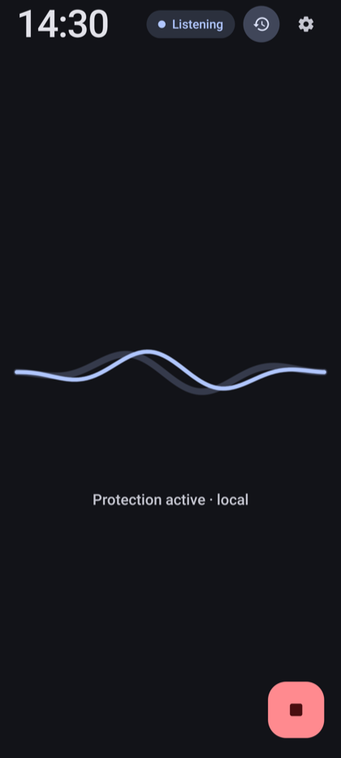
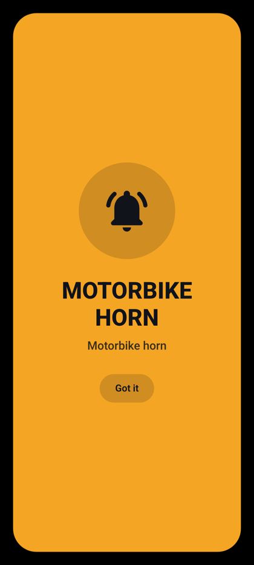
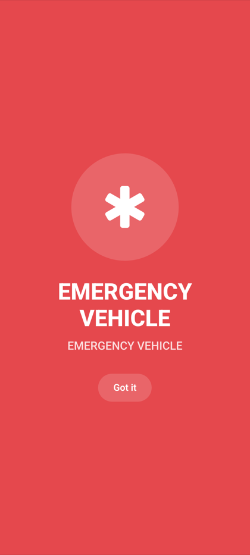
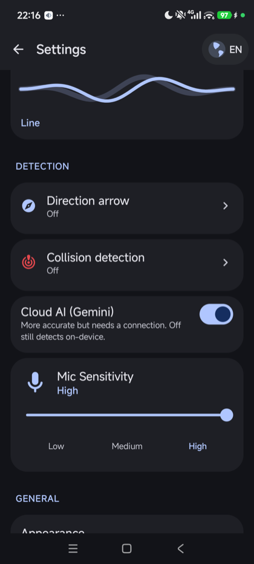
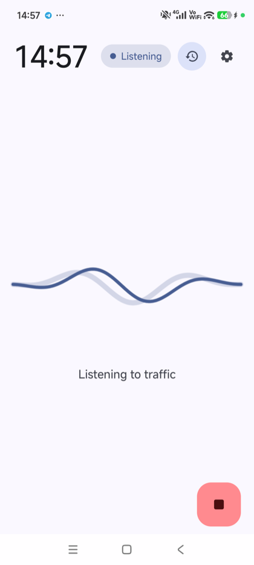
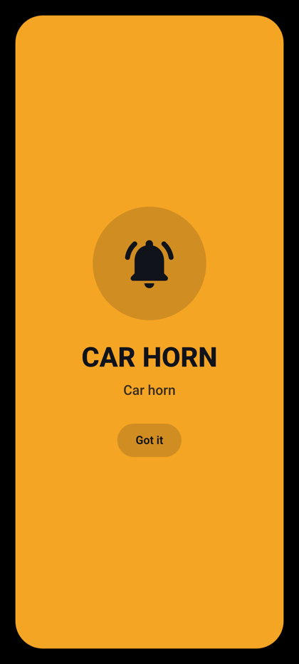
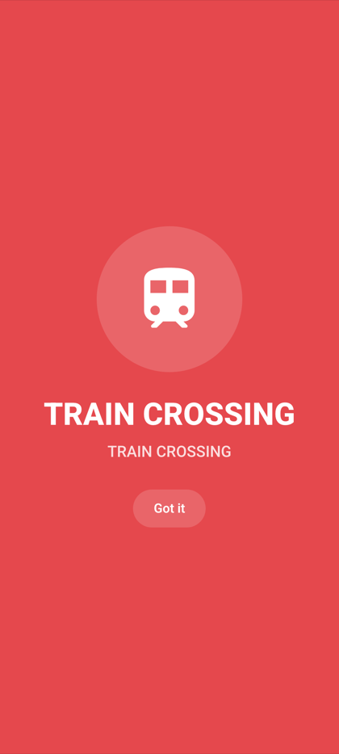
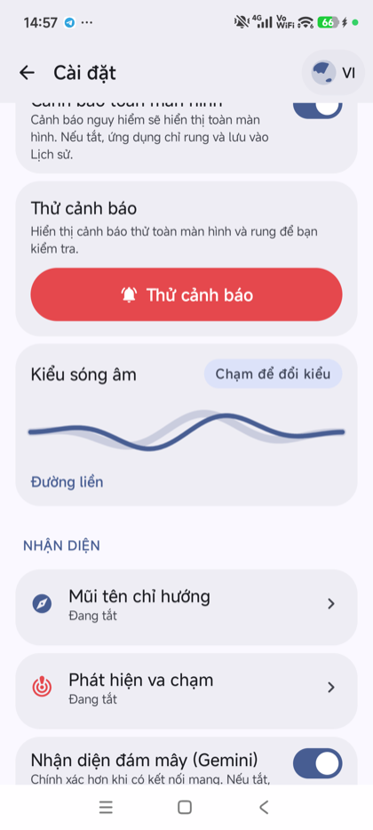

# PulsePath

**See the sound you can't hear.**

PulsePath is an Android app for Deaf and hard-of-hearing motorbike riders. It listens to traffic through the phone's microphones and turns dangerous sounds, such as a horn behind you, a siren or a truck air-horn, into a vibration, a full-screen alert, and a direction cue.

<p align="center">
  
  
  
  
</p>

> **Safety note:** PulsePath is an awareness aid, not a collision-avoidance system. Alerts can be delayed by a few seconds and work best for sirens and distant truck air-horns. Always ride as if the app isn't there.

## Why

Around 2.5 million people in Vietnam are Deaf or hard of hearing, and many ride a motorbike every day. On the road, a horn from behind is often the only warning, and it is the one warning they can't get. PulsePath makes that warning something you can feel and see.

## Features

| | |
|---|---|
| **Instant buzz** | A spike gate watches raw audio energy and vibrates the phone within about 100 ms of a loud sound. No model and no network are involved. |
| **AI label** | About half a second later, on-device recognition (YAMNet) names the sound. |
| **Cloud AI (optional)** | A ~2 second clip can be sent to Google Gemini for a more detailed label, logged to History. Turn it off in Settings and detection stays on-device. |
| **Direction arrow** | Uses the phone's two microphones to show whether a sound came from the left or right. It appears only after calibration and only when the signal is strong enough. If unsure, it shows nothing rather than point the wrong way. |
| **Crash detection** | Audio and motion sensors look for a possible collision and open a help screen for bystanders with your emergency details. It is off by default. |
| **Offline mode** | With no signal the app falls back to local detection and vibration. |
| **Private by design** | No account, no recordings stored on the device. Vietnamese and English. |

## Screenshots

### Home

| Light | Dark |
|:--:|:--:|
|  |  |

The home screen is a clock, a status pill (**Listening**), a **History** button, a **Settings** gear and a pulse wave that reacts to sound. The red button at the bottom starts and stops listening.

### Alerts

Alerts take over the whole screen, with a colour and icon per sound, so you can read them in a glance.

| Warning | Warning | Critical | Critical |
|:--:|:--:|:--:|:--:|
|  |  |  |  |
| Motorbike horn | Car horn | Emergency vehicle | Train crossing |

### Settings

| English | Tiếng Việt |
|:--:|:--:|
|  |  |

The home and settings screenshots were captured from the app on a real Android phone during development. Small layout details may differ slightly from the latest build.

## How to use PulsePath

### 1. Install and open

Build the app (see [Build from source](#build-from-source)) and install it on an Android 8.0+ phone. The app opens straight onto the home screen.

### 2. Allow the microphone

PulsePath asks for the **microphone** permission in a dialog on the home screen. It cannot hear anything without it. Allow notifications too, so that the foreground "listening" notification can stay visible.

### 3. Start listening

Tap the red button at the bottom right. The status pill changes to **Listening** and the wave starts to move. Put the phone where the microphone is not blocked (a handlebar mount or a chest pocket works), and keep the app running; it listens as a foreground service.

### 4. Try a test alert

Open **Settings** (gear icon) and tap **Test alert**. You will feel the vibration and see a full-screen alert, so you know what a real one looks like. Tap **Got it** to dismiss it.

### 5. Tune it

In **Settings** you can:

- change **Mic sensitivity** (Low / Medium / High);
- choose the **wave style** on the home screen;
- turn the **Direction arrow** on and calibrate it;
- turn **Collision detection** on or off;
- turn **Cloud AI (Gemini)** on or off;
- switch between **English and Vietnamese** with the globe button;
- review past alerts in **History** (clock icon on the home screen).

### 6. Ride

When PulsePath hears something, the phone vibrates first, then the alert names the sound. Tap **Got it** once you've seen it. If the arrow appears, it shows which side the sound came from.

## Build from source

**Requirements**

- A recent [Android Studio](https://developer.android.com/studio) (the project uses Android Gradle Plugin 9.1 and Kotlin 2.2)
- JDK 17 or newer (JDK 21 is what the project has been built with)
- An Android phone or emulator on Android 8.0 (API 26) or newer

**Steps**

1. Clone the repository and open the folder in Android Studio. Let it sync Gradle.
2. *(Optional)* Enable cloud labels: copy `.env.example` to `.env`, uncomment `GEMINI_API_KEY` and set it to your own [Gemini API key](https://aistudio.google.com/apikey). Without a key the app still works with on-device recognition and vibration.
3. Run the `app` configuration on your device or emulator.

Run the unit tests with `./gradlew testDebugUnitTest`, or from Android Studio.

> Never commit your `.env` file or API keys. Release signing reads `KEYSTORE_PATH`, `STORE_PASSWORD` and `KEY_PASSWORD` from the environment.

## Project layout

```
app/src/main/java/com/soundsight/
├── audio/     microphone capture, DSP, spike gate, on-device classifier, motion sensing
├── data/      classifiers (local + Gemini) and results
├── domain/    alert policy, direction gate and correlator
├── core/      settings, locale, location helpers, quotas, telemetry
├── light/     light sensor helpers
└── ui/        Jetpack Compose screens: HUD, alerts, settings, history, onboarding
```

The Kotlin package is still `com.soundsight`, the app's original name, so existing installs and signing keep working.

## Built with

Kotlin, Jetpack Compose, Room, YAMNet (TensorFlow Lite) for on-device sound recognition, and Google Gemini for optional cloud classification. Built with Google AI Studio.

## Limits

- Alerts can be delayed by a few seconds, and cloud labels arrive later than the instant buzz.
- Wind, engine and helmet noise reduce accuracy.
- The direction arrow needs calibration and a strong signal.
- Phone makers' battery savers may stop background listening; exclude PulsePath from battery optimization if that happens.

## Contributing and feedback

Issues and ideas are welcome. Open an issue on this repository.
